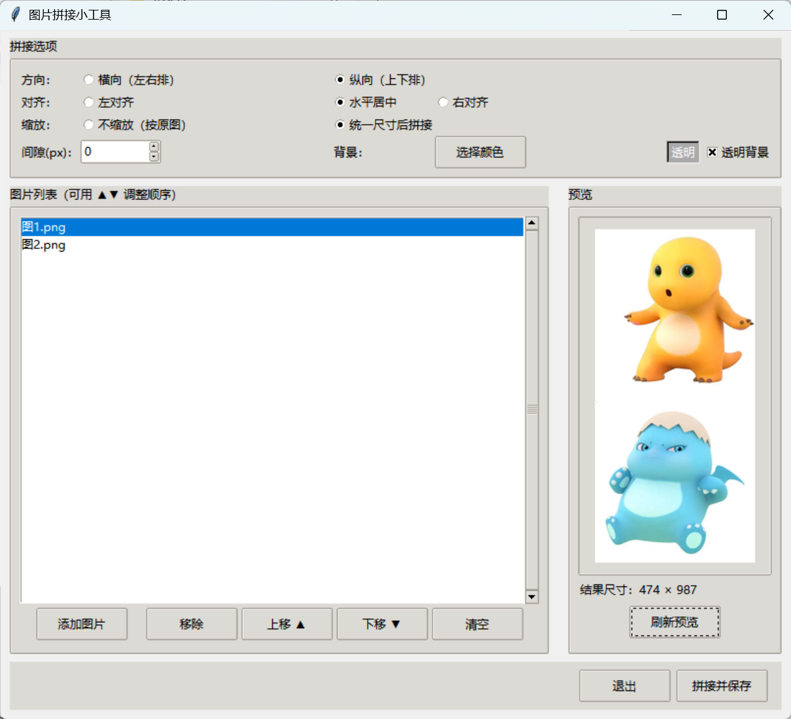

# 图片拼接小工具

一个简单的 Python 桌面程序，把多张图片 **横向（左右）** 或 **纵向（上下）** 拼接成一张。

## 效果预览



## 功能

- 列表带**缩略图**（32px，随 EXIF 方向 / 手动旋转同步），自由添加、移除、**列表内拖拽排序**（多选整块拖动，▲▼ 微调）
- 支持把图片文件拖入列表，也可从剪贴板粘贴图片或复制的图片文件（Ctrl+V）
- 拼接结果可复制到剪贴板，直接粘贴到聊天或文档
- EXIF 方向自动校正（手机竖拍照片不会再横躺着拼）
- 选中图片可左转/右转 90° 手动转正（对付 EXIF 方向信息被剥离的图）
- 对齐方式：
  - 横向时：上对齐 / 垂直居中 / 下对齐
  - 纵向时：左对齐 / 水平居中 / 右对齐
- 缩放模式：
  - 不缩放（按原图尺寸，尺寸不一时间隙用背景色填充）
  - 统一尺寸后拼接（横向统一高度、纵向统一宽度，等比缩放）
- 图片间隙（px）可调
- 背景色可自定义，支持透明背景（输出 PNG 保留透明通道）
- 实时预览：选项 / 列表变动后自动刷新（200ms 防抖），显示结果尺寸与缩略图；也可手动点“刷新预览”
- 输出格式按扩展名自动识别：`.png` / `.jpg` / `.webp`
  - JPG 自动转 RGB 并铺白底（无透明）

## 运行方式

需要 Python 3.10+。推荐使用 uv 管理隔离环境：

```bash
# 首次：安装依赖（会创建 .venv 并安装 Pillow、tkinterdnd2）
uv sync

# 启动图形界面
uv run python app.py
```

若已自行安装 Pillow 与 tkinterdnd2，也可以直接用 Python 运行：

```bash
python app.py
```

## 文件说明

- `app.py` —— tkinter 图形界面
- `stitcher.py` —— 核心拼接逻辑（纯函数，可单独复用 / 单元测试）
- `test_stitch.py` —— 无头测试，覆盖各拼接模式与尺寸断言
- `pyproject.toml` —— 项目与依赖声明
- `assets/app.ico` —— 应用图标（窗口标题栏与 exe），取自 [Flat Color Icons](https://iconify.design/icons/?query=stack)（MIT）经 512px 渲染生成多尺寸 ICO

## 作为库调用（示例）

```python
from PIL import Image
import stitcher

imgs = [Image.open(p) for p in ["a.png", "b.png", "c.png"]]
out = stitcher.stitch(
    imgs,
    direction="horizontal",   # 或 "vertical"
    align="center",           # start / center / end
    scale_mode="none",        # none / unify
    gap=10,
    bg=(255, 255, 255, 255),
)
stitcher.save_result(out, "result.png")
```
